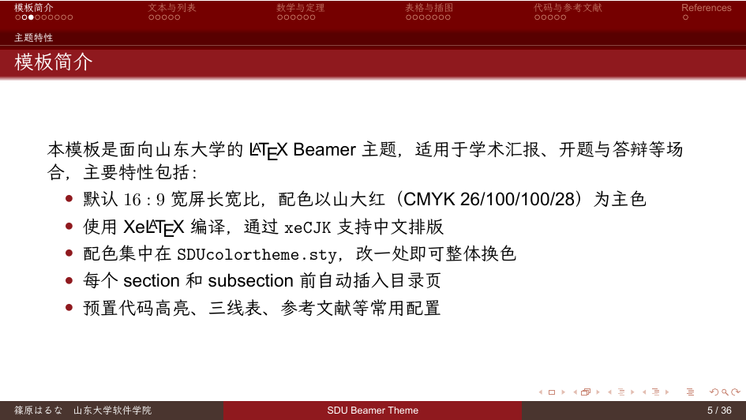
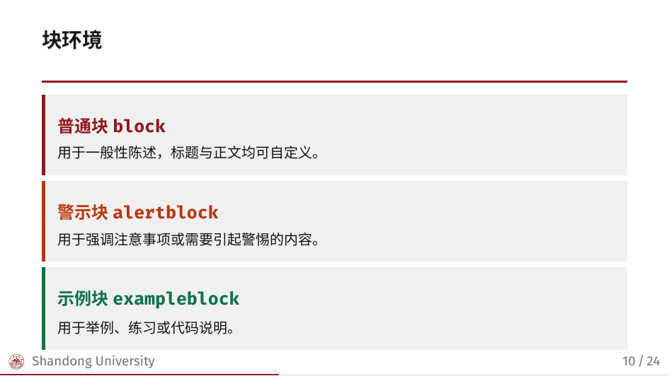

# SDU-Beamer-Theme

[](https://github.com/ShinoharaHaruna/SDU-Beamer-Theme/actions/workflows/online_compile.yml)
[](LICENSE)
[](https://github.com/ShinoharaHaruna/SDU-Beamer-Theme/commits)
[](https://github.com/ShinoharaHaruna/SDU-Beamer-Theme/releases)

[](https://www.overleaf.com/docs?snip_uri=https://github.com/ShinoharaHaruna/SDU-Beamer-Theme/releases/latest/download/SDU-Beamer-Theme-overleaf-xelatex.zip&main_document=slide.tex)

> **尝鲜 `dev` 分支**：现代化重设计——LuaLaTeX 引擎、Moloch/Jacquenetta 设计语言
> （白底无导航条、细进度条、统一左竖条 callout、深色章节页），保留山大红与校徽。
> 本 `main` 分支为经典稳定版。

SDU 的 Beamer 主题，用于学术报告、论文和演讲。

请随时提交问题或提交 PR。如果该项目有帮助，欢迎 Star⭐️。

[English version](./README_EN.md)

## 预览






## 使用方法

1. 如果您的软件环境尚未准备好，请查看*王然*的 [一份简短的关于 LaTeX 安装的介绍](https://mirror.macomnet.net/pub/CTAN/info/install-latex-guide-zh-cn/install-latex-guide-zh-cn.pdf) 或者这篇 [南方科技大学的 LaTeX 指南](https://niko.cra.moe/uploads/short-url/9a47N0ThHXRb6em95R7422y8v7b.pdf).
2. 一些基本的 LaTeX 语法规则也包含在上面的文档中。如果您有任何问题，请先尝试搜索，百试不爽。
3. 克隆此存储库，然后您可以对其进行任何修改！

提示：由 LaTeX Beamer 生成的幻灯片的文档格式为 `pdf`，因此有时与山大的某些课程要求不兼容，它们通常要求 `ppt / pptx` 文件。所以不妨试试 [pdf2pptx](https://github.com/intMojIBakE/pdf2pptx) 或者 [BeamerStyleSlides](https://github.com/wzpan/BeamerStyleSlides)！

---

### 编译

推荐直接使用 `latexmk`，仓库已附带 `.latexmkrc`（指定 XeLaTeX、SyncTeX 与主文档），它会自动调用 `biber` 并重复编译直至收敛：

```bash
latexmk
```

手动等价的编译链如下（本项目按 `biber` 配置参考文献，不推荐使用 `bibtex`）：

```bash
xelatex slide.tex
biber slide
xelatex slide.tex
xelatex slide.tex
```

第一遍 `xelatex` 生成 `.bcf`，`biber` 据此生成 `.bbl`；后两遍 `xelatex` 依次插入参考文献并收敛目录、交叉引用与页码。

对于 Visual Studio Code 用户，如果不想安装 `TeXstudio`，可以安装插件 `LaTeX Workshop`，在 VS Code 中直接编写 LaTeX。

在 `Settings.json` 中找到并修改以下配置：

```json
"latex-workshop.latex.tools": [
    {
        "name": "biber",
        "command": "biber",
        "args": [
            "%DOCFILE%"
        ]
    },
    {
        "name": "xelatex",
        "command": "xelatex",
        "args": [
            "-synctex=1",
            "-interaction=nonstopmode",
            "%DOC%"
        ],
    },
    ……
],

"latex-workshop.latex.recipes": [
    {
        "name": "xelatex -> biber -> xelatex * 2",
        "tools": [
            "xelatex",
            "biber",
            "xelatex",
            "xelatex",
        ]
    },
    ……
]
```

### 字体

> Update 2025/03/03: 在 fonts 目录下添加了
>
> 1. 落霞孤鹜字体。本项目不持有任何相关版权，依据 <https://github.com/lxgw/LxgwWenKai#%E8%AE%B8%E5%8F%AF> 使用
> 2. Arial 字体，使用 GitHub Actions 编译意味着用户接受 Microsoft 的 EULA，以使用 Arial 字体。本项目不持有相关任何版权。
> 3. Sarasa Mono SC 字体。仓库地址：<https://github.com/be5invis/Sarasa-Gothic>；本项目不持有相关任何版权。

在 `slide.tex` 的开头，有以下配置：

```latex
% 字体设置 / Font settings
\usepackage{fontspec} % 字体选择 / Font selection
\usepackage{xeCJK} % 中文字体支持 / Chinese font support

% 设置中文字体 / Set Chinese fonts
\setCJKsansfont[AutoFakeBold]{LXGW WenKai}
\setCJKmainfont{LXGW WenKai}
\setCJKmonofont{Sarasa Mono SC}

% 设置英文字体 / Set English fonts
\setmainfont{Times New Roman} % 主字体 / Main font
\setsansfont{Arial} % 无衬线字体 / Sans-serif font
```

通常需要根据自己的需求修改这些配置。如果使用 Linux，可以通过 `fc-list` 命令查看系统中已安装的字体，或者 `fc-list :lang=zh` 寻找中文字体。

## 有用的网站

- 在线创建 LaTeX 表格：<https://www.tablesgenerator.com/>
- LaTeX 画图画表常用命令：<https://en.wikibooks.org/wiki/LaTeX/Floats,_Figures_and_Captions#Tip>

## Overleaf 模板

完整版 `slide.tex` 超出 Overleaf 免费计划的编译时限，主要表现为编译时间过长被系统限制。实测结论：免费版的主要瓶颈是 `biblatex/biber` 与 CJK 字体缓存这类一次性开销，而非文档本身复杂度；超时后多按几次 Recompile 有机会通过，因为字体缓存会保留在项目内。

每个 release 附带两个预打包的 Overleaf 精简包（由 GitHub Actions 自动生成），点击即可直接在 Overleaf 中打开：

- [](https://www.overleaf.com/docs?snip_uri=https://github.com/ShinoharaHaruna/SDU-Beamer-Theme/releases/latest/download/SDU-Beamer-Theme-overleaf-xelatex.zip&main_document=slide.tex) XeLaTeX 变体，Fandol 字体，中文任意位置可用，推荐。打开后需将 Menu → Compiler 切换为 XeLaTeX（Overleaf 默认 pdfLaTeX）
- [-47A141?logo=overleaf&logoColor=white)](https://www.overleaf.com/docs?snip_uri=https://github.com/ShinoharaHaruna/SDU-Beamer-Theme/releases/latest/download/SDU-Beamer-Theme-overleaf-pdflatex.zip&main_document=slide.tex) pdfLaTeX 变体，与默认编译器一致，开箱即用

仓库附带 `pack_overleaf.sh`，可生成适配免费版的精简包，已验证可编译的组合：

```bash
./pack_overleaf.sh --no-bib              # XeLaTeX 精简包, Fandol 字体, 推荐
./pack_overleaf.sh --pdflatex --no-bib   # pdfLaTeX 精简包, CJKutf8+gbsn, 备用
```

pdfLaTeX 变体的限制：中文仅限正文，标题/章节名/作者信息需用英文，且只有单一宋体字重。

完整体验（参考文献、代码高亮、TikZ 示例、落霞孤鹜/更纱字体）**推荐使用仓库自带的 GitHub Actions 自动构建 PDF**，或直接本地 `latexmk` 构建。Overleaf 免费版下本模板功能受限：仅限精简示例、无参考文献、字体缩减为 Fandol/gbsn。`pack_overleaf.sh --help` 查看全部选项与免费版可用性说明。

## 感谢

- SDU-Beamer-Theme 的原作者是 *Ura*，然而缺少更多相关信息。在 *overleaf* 上查看原项目: <https://www.overleaf.com/latex/templates/sdu-beamer-theme/vfnkydnwgrvc>
- 山大的 `eps` 矢量图校徽来自于：<https://github.com/jshmsjh/SDU-Beamer-Theme>
- 本作品基于 [PKU-Beamer-Theme](https://github.com/inFaaa/PKU-Beamer-Theme)。
- [PKU-Beamer-Theme](https://github.com/inFaaa/PKU-Beamer-Theme) 基于 [THU-Beamer-Theme](https://github.com/tuna/THU-Beamer-Theme)。对上述所有项目表示感谢。

## 协议

该仓库遵循 *MIT 协议*。
